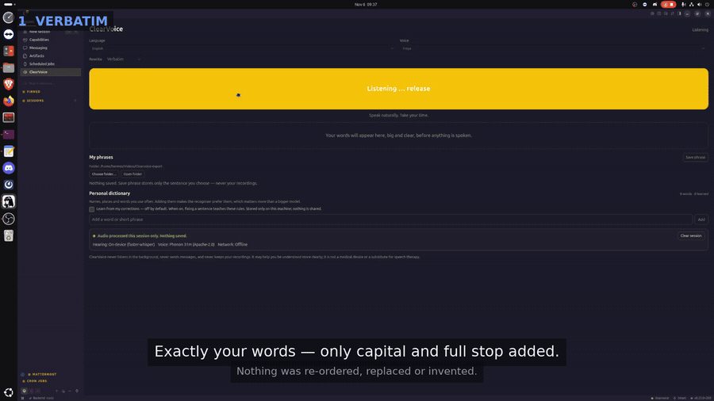

# ClearVoice Hermes Plugin

**A local, private push-to-talk speech bridge for people whose words are hard to
understand — and for anyone who wants their own agent to hear them.**


Hold one button. Speak however you can. Your words appear, large and editable.
Nothing is spoken until you press **Speak it** — then a clear voice on your own
machine says your sentence, in one of seventeen languages.

No account. No upload. No audio written to disk. No language model deciding what
you meant.



**[Watch the 80-second demo](demo/clearvoice-demo.mp4)** — three takes, one per
rewrite style, cut from a single recording session. A lighter copy is at
[demo/clearvoice-demo-720p.mp4](demo/clearvoice-demo-720p.mp4) if your browser
prefers it; rebuild either with `python3 scripts/montage_demo.py`.

> ClearVoice may help people be understood more clearly. It is not a medical
> device, it does not diagnose or treat anything, and it is not a substitute for
> speech therapy.

---

## Contents

[Why this exists](#why-this-exists) ·
[What it does](#what-it-does) ·
[What you see](#what-you-see) ·
[Languages](#languages-what-is-good-what-is-fair) ·
[Accuracy](#accuracy-measured) ·
[Privacy](#privacy-by-construction) ·
[Engines](#engines) ·
[Install](#install) ·
[Use it](#use-it) ·
[Accessibility](#accessibility) ·
[Limitations](#limitations) ·
[Development](#development) ·
[Roadmap](#roadmap)

---

## Why this exists

Roughly one in seven adults lives with a speech difference — aphasia after a
stroke, Parkinson's, cerebral palsy, ALS, stuttering, a tracheostomy, or the voice
that arrives after surgery or with a bad cold. Everyday speech recognition is
trained on typical voices and quietly fails them.

The commercial answer (Voiceitt, Google's Project Relate) is a **per-user trained
model**, which usually means an account, a cloud round trip, a few hundred recorded
phrases, or a closed beta. All three of those solve recognition better than we do.

ClearVoice takes the opposite constraint and lives with its cost:

> **Your voice never leaves this machine, nothing is stored, and the tool never
> pretends to know what you meant.**

That is the product: *hear me exactly, and say it clearly*. Not *improve my
sentence*. Most of the engineering follows from that one line — including the
absence of any language model in the pipeline.

## What it does

```
  microphone ──► RMS gate ──► Whisper small ──► your dictionary ──► rule pack ──► approval ──► voice
   (held)        (silence      (on-device)       (your names,      (verbatim /    (you)      (on-device)
                  costs no                        your places)      literal /
                  model call)                                       courteous)
```

1. **Hold to talk.** The microphone is open only while the button is down; every
   track is stopped the instant you release.
2. **It writes down what it heard**, on your CPU, in memory.
3. **It offers a sentence, large, in the pane.** With `verbatim` — the default —
   those are *your words*, tidied at the edges. You can edit them first.
4. **You press Speak it.** A local neural voice says it. The agent cannot speak for
   you: two independent approval gates sit between a model and your mouth.

The only files the plugin ever writes are your saved phrases and your dictionary,
and only when you press the button that saves them.

## What you see

```
┌──────────────────────────── ClearVoice ────────────────────────────┐
│  ● Audio processed this session only. Nothing saved.  [Clear session] │
│  Hearing: On-device          Voice: On-device          Network: Offline │
├────────────────────────────────────────────────────────────────────┤
│                    ┌──────────────────────────┐                     │
│                    │      Push to talk        │   148 px, huge      │
│                    └──────────────────────────┘                     │
│                                                                     │
│    I need appointment Tuesday move.                                │
│                                 ↑ 24 px semibold, never spoken unseen │
│                                                                     │
│    [ Speak it ]  [ Edit it ]  [ Try again ]  [ Cancel ]             │
└────────────────────────────────────────────────────────────────────┘
```

Six named states — **Ready · Listening · Understanding · Ready to speak ·
Speaking · Error** — and every error is one plain sentence plus the action that
fixes it ("The microphone is blocked. Allow microphone access for Hermes in your
system settings, then try again.").

A static rendering of the main states, drawn from the same tokens as
`desktop/plugin.js`, is in [`docs/pane-mockup.html`](docs/pane-mockup.html).

## Languages: what is good, what is fair

Seventeen languages speak and understand. They are **not** equally good, and
pretending otherwise would be the dishonest part of this project. Three independent
things vary, for three different reasons:

| Tier | Languages | Speaks & understands | Rebuilds the sentence | Why |
|---|---|---|---|---|
| **A — reference** | English | ✅ | ✅ | Phonon 31m voices (Apache-2.0, 37 voices) are the best audio here; Whisper has most training data for English; the grammar pack is written and checked against real usage |
| **B — good** | French, German, Spanish, Italian, Portuguese, Dutch | ✅ | ✅ | Piper `medium` voices are clear but more robotic than Phonon; Whisper is strong in these; the grammar pack (verbs, time spans, determiners, verb-final order for German and Dutch) is written and tested |
| **C — fair** | Polish, Russian, Turkish, Arabic, Hindi, Japanese, Mandarin, Korean, Thai, Vietnamese | ✅ | ❌ *polished only* | one voice each for Japanese, Korean and Thai; less Whisper training data for some; and **no grammar pack** — see below |

**Why tier C has no grammar pack.** A pack is a table of verb forms, time
expressions, frame words, determiners and a courtesy template — about 80 lines,
importable and testable. What it also needs is a **native speaker to check it**.
Shipped unchecked, it produces confident wrong grammar, and the people this tool
serves are the least able to work around a machine that sounds foreign in their own
language. Seven checked languages beat seventeen guessed ones.

What tier C gets instead, and the pane says so in the sentence you read: punctuation
tidied, first letter capitalised, the language's own politeness word appended, a
confirmation question in that language — and **word order untouched**.

```
en  Could you move the appointment to Tuesday, please?          rebuilt
fr  Pourriez-vous déplacer le rendez-vous pour mardi, s'il vous plaît ?   rebuilt
de  Könnten Sie meinen Termin von Dienstag auf Donnerstag bitte verschieben?  rebuilt
es  ¿Podría cambiar mi cita del martes al jueves, por favor?   rebuilt
it  Potrebbe spostare il mio appuntamento da martedì a giovedì, per favore?  rebuilt
pt  Poderia mudar a minha consulta de terça para quinta, por favor?  rebuilt
nl  Kunt u mijn afspraak van dinsdag naar donderdag verplaatsen, alstublieft?  rebuilt
ja  火曜日から木曜日にかえてください、お願いします。                polished
ru  Мне нужно перенести встречу на четверг, пожалуйста.          polished
```

**Recognisers:** `faster-whisper small` for every language (an `.en`-only model is
never left in place for a non-English language — it returns fluent nonsense instead
of an error, the worst possible failure here). `tiny` and `base` remain selectable
overrides; both are measurably worse.

**Voices:** English — Phonon 31m, 37 catalog voices. The other sixteen — Piper, 108
voice models in a bundled offline index (7 French, 10 German, 9 Spanish, 4 Chinese,
3 Hindi, 3 Vietnamese, 1 each for Japanese/Korean/Thai). Japanese needs
`clearvoice[ja]` (pyopenjtalk) and Thai `clearvoice[th]` (tltk, pandas,
unicode-rbnf); the pane prints the exact command when one is missing.

### There is no language model in the path

An earlier version could hand the transcript to a cloud model to "make it clearer".
It paraphrased, dropped details and invented content — so the path is **deleted**,
not hidden behind a switch. A transcript becomes one sentence in three ways, all
local: `verbatim` (your words), `literal` (your words in a plain order), `courteous`
(rebuilt with a checked grammar pack). Unplug the network and every part of this
still works.

## Accuracy, measured

Every number below was produced on the development machine (16-core CPU, no GPU),
with real audio from the local voices through the real recogniser. The scripts are
in `scripts/`.

**Recogniser choice** — four sentences, two French, two English:

| Model | Mean word error rate | Mean time |
|---|---|---|
| `base` | 9.4 % | 1.1 s |
| **`small` (default)** | **3.1 %** | **2.8 s** |
| `medium` | 6.2 % | 15.5 s |

`medium` is both slower and worse on short clips, so `small` is the default
everywhere.

**Personal dictionary** — six runs per condition, French, harder sentences:

| Setup | Mean WER | Mean time |
|---|---|---|
| `base`, no dictionary | 22.6 % | 1.15 s |
| `small` | 5.6 % | 2.80 s |
| `base` + hotword list | 5.6 % | 0.99 s |
| **`base` + personal dictionary (shipped path)** | **3.8 %** | **0.89 s** |

The spread between runs is real — quantised CPU inference wobbles on borderline
words — so read these as orders of magnitude, not a leaderboard. The shape is what
matters: **your own words beat a bigger model**, at no latency cost.

The dictionary lives in the pane:

- **Add words** you say often (a name, a street, a treatment). They are passed to the
  recogniser as a prompt and also normalise the spelling in the transcript, so
  `rendez vous`, `rendezvous` and `rendez-vous` are one entry.
- **Learn from my corrections** — off by default. When you fix a sentence, the pair
  "what it heard → what you meant" is stored locally and applied to later
  transcripts.
- Everything is visible, deletable in one click, and lives in `dictionary.json`.
  **Nothing is shared**: no community packs, no upload, no telemetry.

**What raises accuracy, in order of effect:** your own word list; a larger
recogniser; more of your speech for adaptation. The first is built in, the second is
a setting, the third is the honest gap — see [Roadmap](#roadmap).

## Privacy by construction

| Question | Answer |
|---|---|
| Is the microphone ever always-on? | No. Opened on press, every track stopped on release; the stream is torn down on unmount. |
| Where does audio live? | In memory, for the seconds between release and transcription. |
| Is audio written to disk? | Never. No WAV, no temp recording, no cache. Enforced by tests using a CPython audit hook. |
| Are transcripts stored? | Only in RAM for the current session, so you can re-read or repeat. **Clear session** empties it; a restart starts empty. |
| Is anything sent off-device? | Not by default: the local path makes **no network call at all**. Gradium cloud is opt-in, off by default, keyed to your own account, and selected per backend. |
| Telemetry, accounts, profiles? | None of the three. No analytics endpoint, no login, no behavioural memory. |
| What *is* on disk? | `phrases.json` and `dictionary.json`, in the plugin's own data directory, on an explicit action. |
| Can it send messages? | No. It speaks into the room. No email, calendar, files, contacts or messaging capability is requested. |

Full statements: [PRIVACY.md](PRIVACY.md) · [SECURITY.md](SECURITY.md).

## Engines

| | Default | Alternative |
|---|---|---|
| Speech → text | `faster-whisper` `small`, CPU | Gradium ASR (cloud, opt-in, triple-gated) |
| Text → speech, English | **Phonon 31m** (Apache-2.0, 37 voices) | Piper |
| Text → speech, other 16 | **Piper** (MIT runtime, 108 voices) | Gradium TTS (cloud, opt-in) |

Why two synthesis engines: Gradium's only permissively licensed Phonon checkpoint is
English — the multilingual 40m model is **CC BY-NC** and cannot ship in an MIT
plugin. Piper fills every other language under MIT. Neither makes a network call
while you speak; each downloads a model once, on first use, and says so.

A short English sentence synthesises in **0.8–1.3 s** on a small desktop CPU; Piper
runs French in **0.26 s** for 3.3 s of audio. There is no GPU path and no streaming
TTS in this version.

**Gradium cloud** (optional): select the backend, enable **Allow cloud speech**, add
your own key. Three consents must line up before a byte leaves the machine, and
there is no silent fallback from local to cloud. The key is read through Hermes's
secret scope, never logged or displayed.

## Install

### From the catalogue (once listed)

```bash
hermes plugins install clearvoice
hermes gateway restart
```

### From git

```bash
git clone https://github.com/thebangarang/clearvoice-hermes-plugin.git \
  ~/.hermes/plugins/clearvoice
hermes plugins enable clearvoice      # resolves Python dependencies
hermes gateway restart                # a running gateway never switches envs
```

### From a local checkout (development)

```bash
hermes plugins link /path/to/Clearvoice-hermes-plugin
hermes plugins validate /path/to/Clearvoice-hermes-plugin --install-deps
hermes gateway restart
```

Then, in Hermes Desktop: **Capabilities → Plugins → ClearVoice → enable**, and
**Rescan** if the sidebar row is missing. The Desktop half is a separate, deliberate
switch; the pane does not appear until you flip it.

Voice models are downloaded from a **pinned commit** of `rhasspy/piper-voices` and
verified against the sha256 Hugging Face publishes for each file; a mismatch is
discarded, never loaded.

**Requirements:** Hermes Agent ≥ 0.22.0, Python 3.10+, `ffmpeg` on `PATH`, a working
microphone, and ~600 MB of disk for the speech model plus one voice. First use
downloads them; afterwards the network can stay unplugged.

**Verify:**

```bash
hermes plugins validate . --install-deps   # 16 checks, no host override
hermes plugins doctor .                    # registrations: 3 tool(s), 0 hook(s)
python -m pytest -q                         # 160 tests, ~2 s, no network
python scripts/smoke_test.py                # real models, real audio, no microphone
```

## Use it

| Action | How |
|---|---|
| Talk | Hold **Push to talk** (mouse, touch, or hold Space/Enter while focused) |
| Talk without holding | Not supported on purpose — a stuck key must not become an open microphone |
| Change the sentence | **Edit it** → type → **Done editing** → **Speak it** |
| Hear it again | **Speak it** again; the sentence stays until you cancel |
| Start over | **Try again**, or **Cancel** (which also clears the session) |
| Save a phrase you use often | Approve it, then **Save phrase** in *My phrases* |
| Use it from a chat | `/clearvoice` opens the pane; `/clearvoice <words>` proposes a sentence |
| Choose a voice | Language → voice in the pane; remembered in `ctx.storage`, never in `config.yaml` |

### Three tools for the agent

| Tool | Input → output | Use it for |
|---|---|---|
| `clearvoice_transcribe` | audio path → transcript (+ optional sentence) | dictation, voice notes, meeting snippets, subtitles |
| `clearvoice_speak` | text → **queued** for the user to speak (or one WAV with `deliver: "file"`) | an agent that asks for a line, voice-over |
| `clearvoice_say_back` | audio → transcript → sentence → **queued** | repeating an unclear recording clearly |

Neither tool can speak. They queue a sentence, and the queue holds **text, never
audio**:

```jsonc
// what a model gets back — every time, with no parameter that changes it
{"queued": true, "spoken": false, "awaiting_user": true,
 "text": "I need appointment Tuesday move.",
 "instruction": "ClearVoice is showing this sentence in its pane. Nothing is spoken until the user presses Speak it there. Do not call this tool again to try to force playback."}
```

The pane polls `/pending`, which returns that text **and a single-use token** — no
`audio_b64`, so polling cannot play anything. The sentence appears as a proposal;
only the user's **Speak it** press redeems the token, and `/speak` refuses a wrong,
missing, reused or expired one. Editing the sentence also throws the token away, so
the audio that plays is provably the text on screen.

`deliver: "file"` is the one path where a tool can trigger synthesis, and it speaks
into no room: it writes exactly one WAV into the plugin's `speech/` folder, and it
stays **off** until you enable *Allow speech files*.

Earlier versions had a `confirm_required` boolean here. That was not a gate — the
model supplied the value — so it was removed along with the autoplay it enabled.
See [decisions.md](decisions.md) D-022.

A bundled skill (`skills/clearvoice/SKILL.md`) teaches the agent when to reach for
each tool and that the approval gate is not optional.

### From a script, a workflow, another app

```bash
hermes clearvoice say "The pharmacy closes at six." --json
hermes clearvoice hear ~/notes/voice-note.webm --json --reframe
hermes clearvoice say-back ~/notes/mum.webm --out ~/notes/clear.wav
```

Four surfaces, loosest coupling first: the CLI with `--json`, the plugin's loopback
HTTP routes (`/api/plugins/clearvoice/`), a plain Python import of
`clearvoice_engine` (no `ctx`, no gateway, no config), and the three agent tools.
Recipes and the route table: [docs/INTEGRATION.md](docs/INTEGRATION.md).

## Accessibility

- **148 px** push-to-talk target, **24 px** sentence, **18–20 px** body — above WCAG AA.
- **Theme-native contrast:** text and panels use the app's tokens, so the pane
  follows light/dark and every theme instead of hardcoding a palette that fails one.
- **Full keyboard path:** Tab to the button, hold Space or Enter to talk, release to
  stop. Every action is a real `<button>`; focus rings are never removed.
- **Screen readers:** the sentence is an `aria-live="polite"` status region, errors
  are `role="alert"`, and the button reports `aria-pressed` while listening.
- **No time limits:** no countdown, no auto-dismiss, no auto-speak. Stare at the
  sentence as long as you like.
- **No dark patterns:** no pre-ticked cloud toggle, no upsell, no focus trap, no
  confirmation that is easier to accept than to decline.
- **One decision per screen:** one sentence, four buttons. It is an assistive
  device, not a dashboard.

## Limitations

Stated plainly, because a user or a judge will find them anyway.

- **No speaker adaptation.** A general Whisper on an atypical voice is worse than a
  model trained on that speaker. Voiceitt asks for 50–200 recorded phrases, Project
  Relate asked for 500. We ask for a word list — cheaper, weaker. This is the single
  biggest gap in the product.
- **Ten of seventeen languages do not re-order a sentence** (tier C above), and the
  non-English Piper voices are more robotic than Phonon.
- **~3 s after you release the button** with `small` on a slow CPU. There is a
  spinner; it is not instant.
- **The reframer is not a language model.** It handles fragmented, telegraphic
  speech well and long meandering sentences poorly. When unsure it asks instead of
  guessing — expect that on unusual sentences.
- **A muted microphone looks like silence.** The pane says "I didn't catch that"; it
  cannot tell you the microphone is off.
- **Single utterance at a time.** No wake word, no continuous dictation, no
  conversation mode — those are the behaviours this plugin exists to avoid.
- **No voice cloning.** 37 English and 108 Piper voices, chosen not trained.
- **A queued sentence waits 120 seconds.** If you do not press Speak it in that
  window the request expires and has to be asked for again — a deliberate limit, so
  nothing old can be replayed later.
- **Cloud speech is not exercised by the test suite.** The Gradium paths follow the
  documented REST contract and fail loudly and early, but without a key they are
  unverified until you run them once.
- **Not a medical device**, and not a substitute for speech therapy.

## Development

```bash
python3 -m venv .venv && .venv/bin/pip install -e ".[dev]"
.venv/bin/python -m pytest -q          # 160 tests, ~2 s, no model download
hermes plugins validate . && hermes plugins doctor .

python3 scripts/montage_demo.py        # rebuild the demo from three takes in ~/Videos
python3 scripts/montage_demo.py --no-music --order courteous,verbatim,literal
```

| Script | What it does |
|---|---|
| `accuracy_bench.py` | word error rate and latency, per model and per dictionary setup |
| `montage_demo.py` | trims the OBS UI off recorded takes, labels each style, builds the 80 s video |
| `cut_demo.py` | single-take variant: cuts one long recording to 90 s using silence detection |
| `api_selftest.py` | exercises every REST route with real audio, without a running gateway |
| `lang_probe.py` | synthesises a sentence in every language and reports what worked |
| `piper_diagnose.py` | explains a silent Piper voice (missing phonemiser) |

### Structure

```
clearvoice_engine/        # the pipeline, Hermes-free and importable
├── audio.py              # bytes in, float arrays out — never a file
├── stt.py                # local faster-whisper · Gradium cloud
├── tts.py                # engine routing: Phonon (en) · Piper (others) · Gradium
├── langs.py              # 17 languages, voice index, Whisper-model mapping
├── piper.py              # MIT local engine for every non-English language
├── intent.py             # reframer entry point + shared scoring
├── intent_fr.py          # French grammar pack
├── intent_packs.py       # data-driven packs: de, es, it, pt, nl
├── intent_langs.py       # polish tier: politeness + confirmation per language
├── propose.py            # the one place a transcript becomes a sentence
├── lexicon.py            # your words, learned corrections (opt-in)
├── privacy.py            # session store, saved phrases
├── cloud.py              # Gradium REST, gated and key-safe
├── runtime.py            # in-process session state + audio outbox
├── settings.py           # validated settings view
└── data/piper_voices.json  # 108 voices, bundled so the picker works offline

dashboard/plugin_api.py   # FastAPI router the pane talks to (loopback only)
desktop/plugin.js         # the pane: one ESM file, @hermes/plugin-sdk only
skills/clearvoice/        # the skill that teaches the agent the three tools
tests/                    # privacy, packaging, languages, reframer, lexicon, demo
docs/                     # INTEGRATION.md · DEMO.md · pane-mockup.html
```

Two deviations from the original build brief, both forced by the platform:

1. **The Desktop UI is one ESM `plugin.js`, not four `.tsx` files.** Hermes Desktop
   loads a disk plugin uncompiled — JSX cannot be parsed, and the only importable
   specifiers are `@hermes/plugin-sdk`, `react` and `react/jsx-runtime`. The four
   components named in the brief exist as separate components in that file, written
   with `jsx()` calls.
2. **The engine is `clearvoice_engine/` at the plugin root**, not a nested package
   of the same name as its parent — a nested package breaks path-based imports; the
   flat, uniquely named one is importable from both entry points and the tests.

Decisions and their rejected alternatives: [decisions.md](decisions.md). What
happened when, mistakes included: [worklog.md](worklog.md).

## Roadmap

1. **Speaker adaptation** — the honest fix for accuracy. Euphonia's research shows
   useful adaptation from 3–4 minutes of a speaker's audio; a personal acoustic
   adapter, kept on-device, is the difference between "works for clear speech" and
   "works for this person".
2. **More grammar packs**, each with a native reviewer. Next: Russian, Polish,
   Turkish.
3. **Phrase-bank matching** — recognise *your* recorded phrases by voice, the
   discrete approach commercial tools used before per-speaker models.
4. **Streaming TTS** and a GPU path, for sub-second time-to-first-word.

## Hackathon submission

- [x] Installs cleanly (`hermes plugins install` / linked checkout)
- [x] Pane, page, sidebar row, palette command, status chip
- [x] Push-to-talk capture (pointer, touch, keyboard, pointer-capture safe)
- [x] Local STT verified end to end; optional cloud backend implemented off by default
- [x] Local TTS in 17 languages, verified by real synthesis
- [x] Reframing: 7 checked grammar packs, 10 honest polish tiers
- [x] Nothing persisted during normal use (audit-hook tested)
- [x] `validate` and `doctor` pass; 160 tests
- [x] Public repository published, demo video cut
- [ ] Catalogue pull request opened

Pitch, verification table and submission state:
[HACKATHON_SUBMISSION.md](HACKATHON_SUBMISSION.md).

## Licence

MIT — see [LICENSE](LICENSE). Phonon voices Apache-2.0 via `ptts`; Piper MIT;
faster-whisper MIT; Whisper weights MIT.

Not affiliated with Voiceitt or Google Research: their products solve the recognition
problem more thoroughly. This one solves a different constraint — no account, no
cloud, no trace — and says so.
